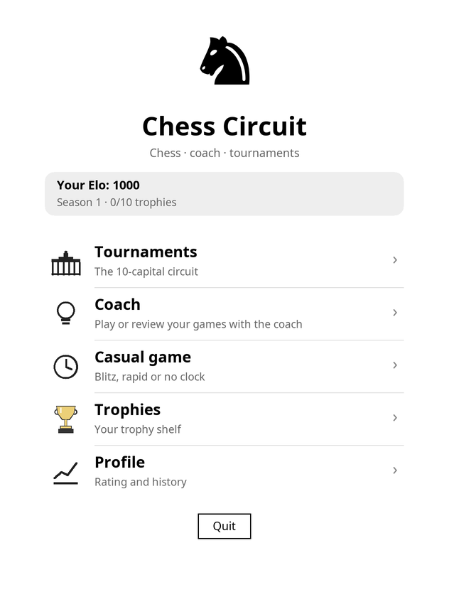
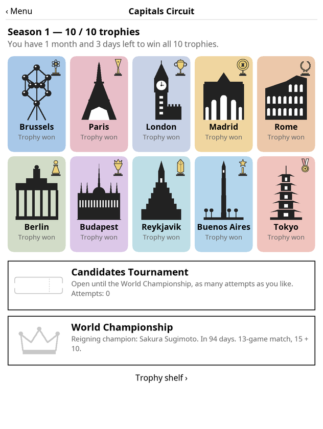
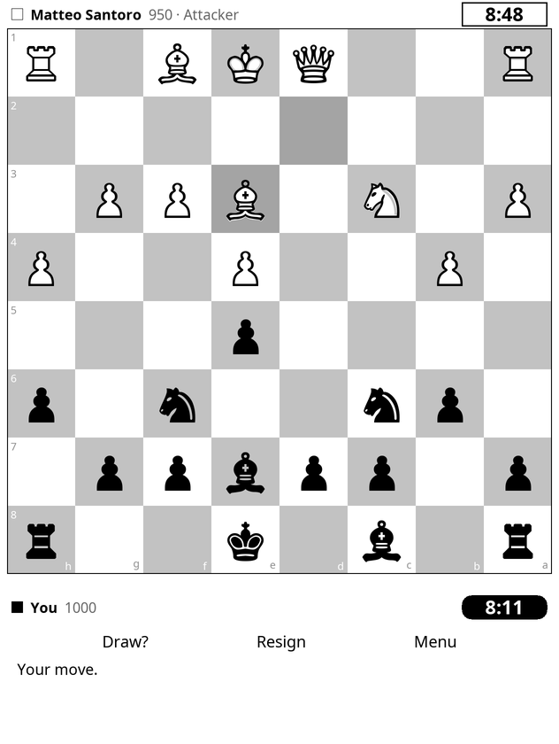
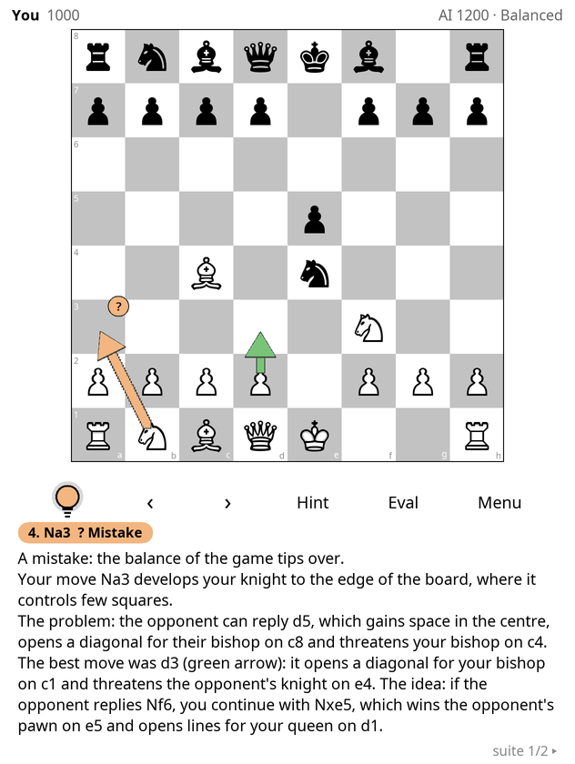
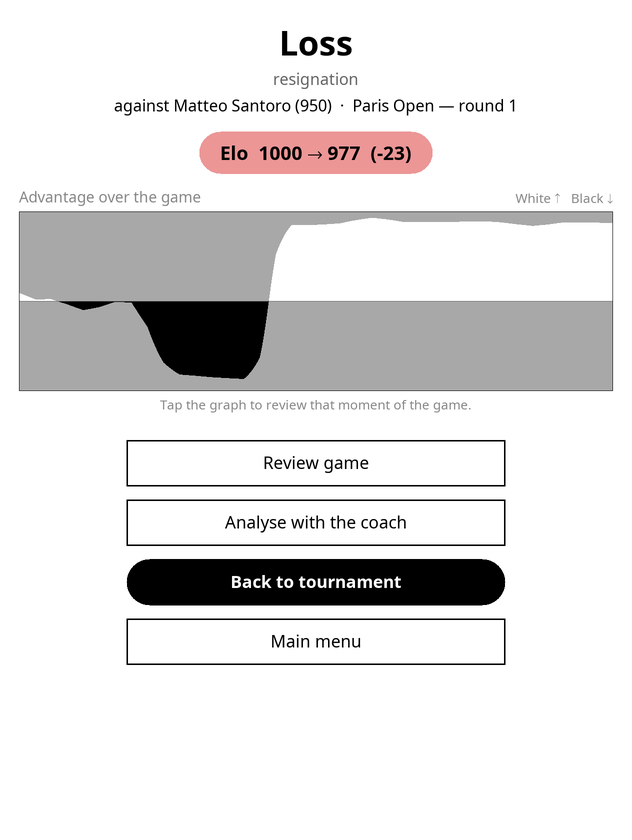
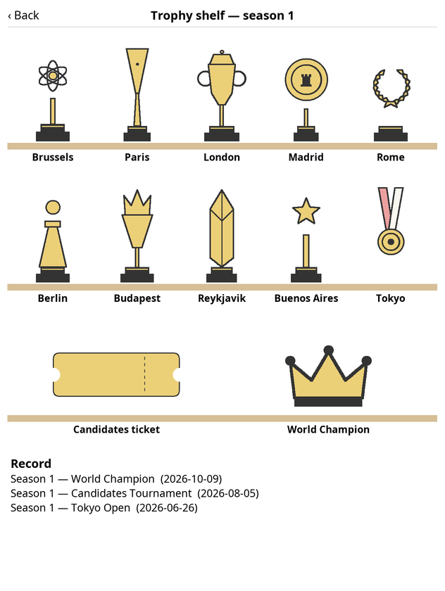
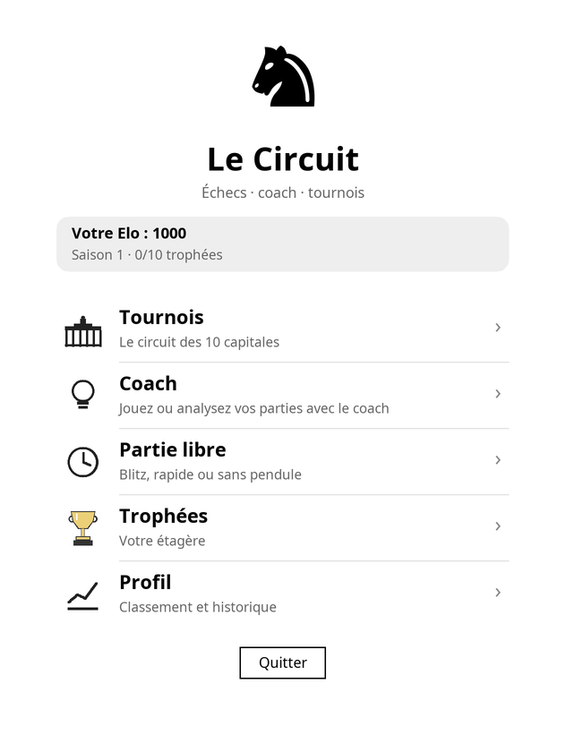
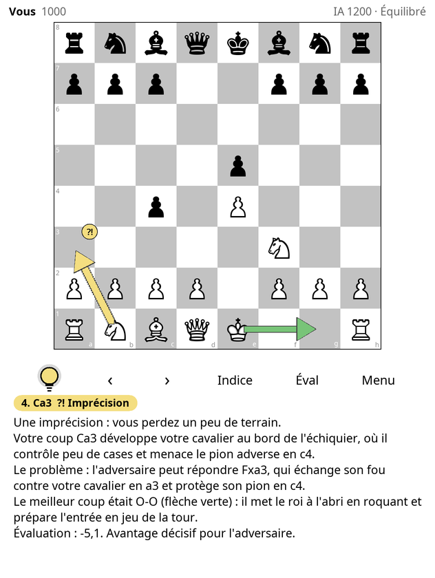
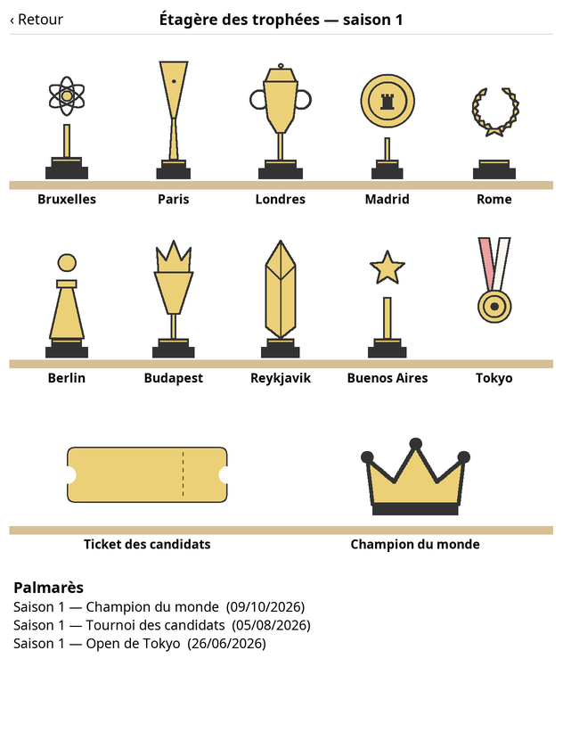

# Chess Circuit — a chess game for KOReader

A complete, fully offline chess game for e-readers running [KOReader](https://github.com/koreader/koreader),
designed for the colour e-ink screen of the Kobo Libra Colour (it also works in black and white).

The game is available in two languages, in two separate plugin folders:

| Language | Folder | Name in KOReader | Save file |
|---|---|---|---|
| English | [`english/chesscircuit.koplugin`](english/chesscircuit.koplugin) | Tools → **Chess Circuit** | `koreader/settings/chesscircuit.lua` |
| French | [`french/chesscoach.koplugin`](french/chesscoach.koplugin) | Tools → **Le Circuit (échecs)** | `koreader/settings/chesscoach.lua` |

Both versions have exactly the same features; only the interface and the coach's explanations differ
(the French version also uses French piece letters: R, D, T, F, C). They use different folder and save-file
names, so both can be installed side by side.

It bundles the Stockfish engine and adds three ways to play:

- **Coach**: play against an AI from 400 to 2500 Elo, in five playing styles. Tap the light bulb whenever you want
  the coach's opinion. Each move gets a chess.com-style verdict (brilliant, great, best, excellent, good,
  inaccuracy, mistake, miss, blunder) with coloured arrows and a plain-language explanation of what the move does (in English or French).
- **Tournaments**: a season-long circuit of 10 tournaments in 10 capitals, with made-up opponents who play like humans.
- **Casual games**: blitz 3 + 5, rapid 10 + 5 or no clock.

| | | |
|---|---|---|
|  |  |  |
|  |  |  |

French version:

| | | |
|---|---|---|
|  |  |  |

## Features

### Requirements

- An e-reader running KOReader. It was designed for the **Kobo Libra Colour**; other Kobo devices with an ARM processor should work.
  Colours are pastel on colour screens and switch to shades of grey on black and white screens.
- Nothing else: no internet connection, no account. Everything runs on the device.

### Coach mode
- The board stays clean while you play; nothing pops up after your moves.
- Tap the **light bulb** to see your last move's verdict, an arrow for your move, a green arrow for the best move,
  and an explanation: development, centre control, open lines, threats, forks, pins, hanging pieces,
  the opponent's best reply and the idea behind the best move.
- **‹ ›** (or the reader's page-turn buttons, or a swipe) step back and forth through the game, including the AI's moves.
  Replay the same move and the AI answers exactly as before; play a different move to branch off from there.
- **Eval** shows or hides a horizontal evaluation bar under the board.
- **Hint** gives a discreet hint first, then the move.
- **Analyse a past game**: any finished game from any mode can be reopened in the coach for a move-by-move review.

### Tournaments
- 10 opens (Brussels, Paris, London, Madrid, Rome, Berlin, Budapest, Reykjavik, Buenos Aires, Tokyo):
  8 players, 6 Swiss-system rounds, 10 + 5, standings between rounds. Each city has its own trophy.
- Around 150 made-up circuit players close to your rating, each with a personality (attacker, positional, solid,
  tactician, deep thinker, blitzer, balanced). They think at a human pace, play worse when short of time
  and in faster time controls, may accept draws, and resign lost positions.
- Real chess clocks with increment, draw offers and resignation. No coach and no takebacks.
- **Premoves**: while the opponent is thinking, tap one of your pieces and then a target square. Both squares turn blue
  and the move is played as soon as the opponent has moved, if it is still legal. Tap elsewhere to cancel.
- A real-time season of 365 days, starting with your first tournament. You have 10 months to win all 10 trophies.
  If you do, the **Candidates Tournament** unlocks (6 rounds, 15 + 10, slightly stronger field).
  On day 364 comes the **World Championship**: a 13-game match against the reigning champion.
- Progress, clocks and games are saved, so you can stop at any time and resume later.

### After each game
- A summary screen with the result, your Elo change, accuracy (coach games) and an advantage graph
  (white area up when White is better, black area down when Black is better). Tap the graph to jump to that moment.
- Your Elo rating goes up and down after every rated game. The profile screen shows its history.

## Installation

1. Download this repository (green **Code** button → **Download ZIP**) and unzip it.
2. Connect the e-reader to your computer with a USB cable.
3. Copy the plugin folder of your language to `koreader/plugins/` on the device
   (on Kobo the folder is hidden: `.adds/koreader/plugins/`):
   - English: `english/chesscircuit.koplugin`
   - French: `french/chesscoach.koplugin`
4. Eject the reader safely and restart KOReader.
5. Open the top menu → **Tools** → **Chess Circuit** (or **Le Circuit (échecs)**).

To update, replace the plugin folder with the new one. Your rating, history and season progress are kept,
because they live in the save file, not in the plugin folder.

## Tips

- The reader's **page-turn buttons** step through the game (back / forward) in coach mode and when reviewing finished games.
- A long press on **‹** or **›** jumps to the start or the end of the game.
- In coach mode, the AI level (400–2500 Elo), its style and the analysis time are in **Menu**.
  A longer analysis time gives a more accurate coach but uses more battery.
- Coach games in which you took moves back are not rated.

## About the engine

The `bin/stockfish` file inside each plugin folder is **Stockfish 11** (GPL v3, <https://github.com/official-stockfish/Stockfish>, tag `sf_11`),
statically cross-compiled for 32-bit ARM (armv7, hard-float), which runs on Kobo devices.
It includes one small patch (`bin/stockfish_patch.diff`) that lets a search finish when its input ends.
Stockfish 11 was chosen because it needs no neural-network file and is light enough for an e-reader.

To rebuild it yourself:

```sh
git clone --depth 1 --branch sf_11 https://github.com/official-stockfish/Stockfish.git
cd Stockfish && git apply ../english/chesscircuit.koplugin/bin/stockfish_patch.diff && cd src
make build ARCH=armv7 COMP=gcc CXX=arm-linux-gnueabihf-g++ EXTRALDFLAGS="-static"
arm-linux-gnueabihf-strip stockfish
```

On other devices (for example an x86 Linux build of KOReader), replace `bin/stockfish` with a Stockfish binary built for that platform.

## How it works

Everything is plain Lua on top of KOReader's widgets, with no extra libraries.
The two folders contain the same files:

| File | Role |
|---|---|
| `cc_chess.lua` | Chess rules, move generation (perft-verified), SAN notation |
| `cc_engine.lua` | Runs Stockfish in the background without freezing the screen |
| `cc_ai.lua` | Level-based move choice, playing styles, human-like personalities, thinking times and time-pressure stress |
| `cc_coach.lua` | Move classification and plain-English explanations |
| `cc_match.lua` | A game in any mode: navigation, takebacks, clocks, premoves, draw offers, analysis |
| `cc_tournament.lua`, `cc_career.lua`, `cc_names.lua` | Swiss pairings, season calendar, circuit players |
| `cc_screen.lua`, `cc_menus.lua`, `cc_ui.lua`, `cc_board.lua`, `cc_art.lua`, `cc_draw.lua`, `cc_lamp.lua` | Screens and hand-drawn graphics |
| `cc_app.lua`, `main.lua` | Glue code and KOReader plugin entry point |

All players and their names are made up. Any resemblance to real people is coincidental.

## License

GPL-3.0, see [LICENSE](LICENSE). The bundled Stockfish binary is also GPL-3.0.
